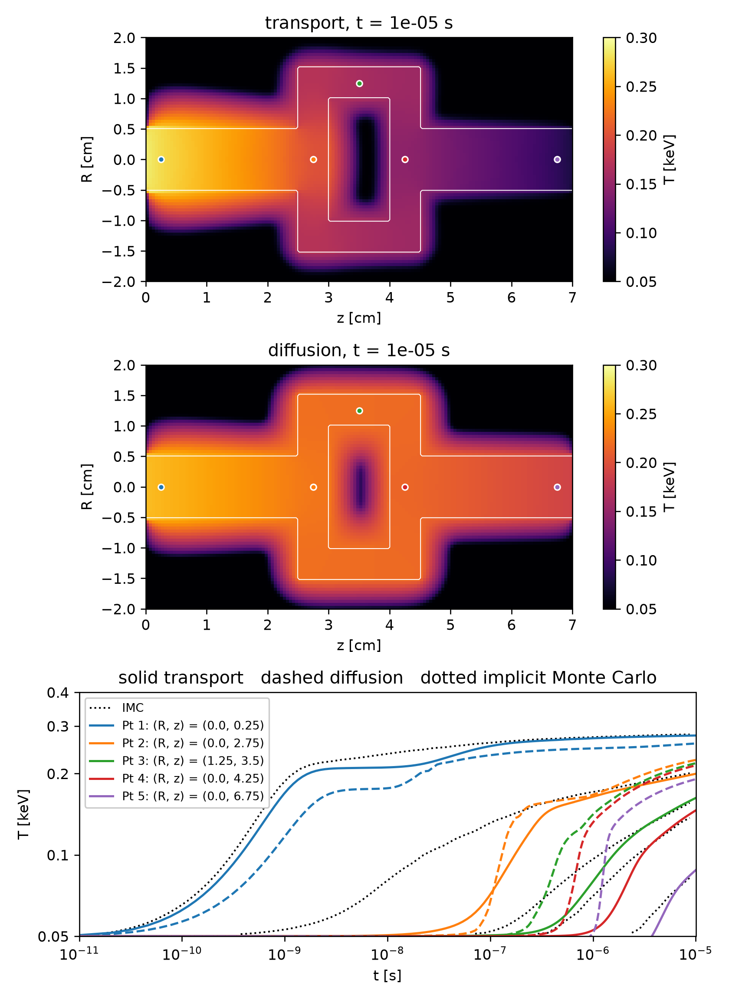
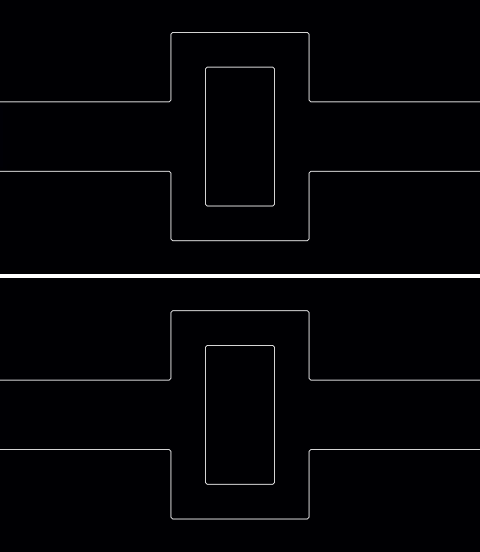

# Crooked pipe

Simulate the crooked pipe, comparing radiation transport and flux-limited
diffusion against implicit Monte Carlo

Philip Mocz (2026)

Usage:

```console
python crooked_pipe.py
```

Takes around 12 minutes to run on my macbook (cpu): 9 for the transport and 3
for the diffusion. Run a single method with `--method transport` or
`--method diffusion`.

A thin, winding pipe (density 0.01 g/cc, absorption 0.2 /cm) runs through an
optically thick wall (density 10 g/cc, absorption 200 /cm), in axisymmetric
`(R,z)` geometry. Radiation at 0.3 keV floods in through the mouth of the pipe
at `z = 0`, flows down it and around its two bends, and slowly heats the walls,
which start, like the pipe, at 0.05 keV. The material is static: it only
exchanges energy with the radiation. The temperature is recorded at five points
along the pipe (the dots), and compared against the implicit Monte Carlo (IMC)
solution of Brantley et al. (2019) (digitized from their Figure 4a, in
`imc_reference.txt`; dotted lines). The timestep starts at 1e-11 s and grows by
10% a step up to 1e-8 s, as in that paper, which only implicit radiation solvers
allow.

This is a standard test of radiation flowing through optically thin channels in
optically thick material. Discrete ordinates transport (solid lines, 16
directions) agrees with IMC: the temperatures at 1e-5 s are within 7%
(0.277, 0.200, 0.163, 0.146 and 0.088 keV against 0.279, 0.201, 0.156, 0.137 and
0.082 keV), and the pipe heats up at the right times, if a little late at the
second point (2.6x) and the third and fourth (20%). That lag is set by the
spatial resolution, rather than the angular: halving the cells cuts it
from 5x to 2.6x, while 64 directions instead of 16 hardly change it.

Flux-limited diffusion (dashed lines) fails, as it is known to: it carries the
radiation around the bends far too easily, heats the third, fourth and fifth
points three to five times too early, and leaves the far end twice too hot. With
transport, the radiation that reaches the walls is soaked up by them, and only
the heated walls slowly pass it along.


## Simulation snapshots

<div style="display:flex;flex-wrap:wrap;gap:8px">
  
  
</div>

The movie shows the temperature with transport (top) and diffusion (bottom), at
times spaced evenly in log time from 1e-11 to 1e-5 s.


## References

Graziani, F. & LeBlanc, J.; The crooked pipe test problem. Lawrence Livermore
National Laboratory Report UCRL-MI-143393 (2000)

Brantley, P. S. et al.; A new implicit Monte Carlo thermal photon transport
capability developed using shared Monte Carlo infrastructure. M&C 2019,
LLNL-CONF-771646 (2019)

[Levermore, C. D. & Pomraning, G. C.; A flux-limited diffusion theory. The Astrophysical Journal (1981)](https://ui.adsabs.harvard.edu/abs/1981ApJ...248..321L)
