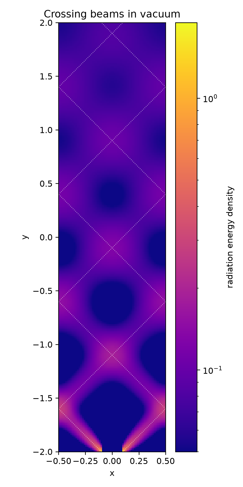

# Crossing beams

Simulate two beams of photons crossing in vacuum (radiation transport)

Philip Mocz (2026)

Usage:

```console
python crossing_beams.py
```

Takes around 7 seconds to run on my macbook (cpu).

Two beams are injected at the bottom of a box with no opacity, at `x = ±0.1`,
and travel diagonally upwards at 45 degrees. The box is periodic in `x`, so the
beams wrap around and cross each other again and again on their way out through
the top. The dotted lines in the summary plot are their straight paths.

Discrete ordinates carry each beam along its own direction, so the beams pass
through each other undisturbed. A radiation fluid (M1) would instead merge them
into one beam heading straight up. The beams do spread, since the transport is
first order in space, as in the reference.

With no opacity, the implicit solver has only the transport to iterate on, which
makes this the hardest case for its convergence. Each timestep here is a tenth of
the light-crossing time of the box, i.e. ~13 cells per step.


## Simulation snapshots

<div style="display:flex;flex-wrap:wrap;gap:8px">
  
  
</div>


## References

[Jiang, Y.-F.; An Implicit Finite Volume Scheme to Solve the Time-dependent Radiation Transport Equation Based on Discrete Ordinates. The Astrophysical Journal Supplement Series (2021)](https://ui.adsabs.harvard.edu/abs/2021ApJS..253...49J)
