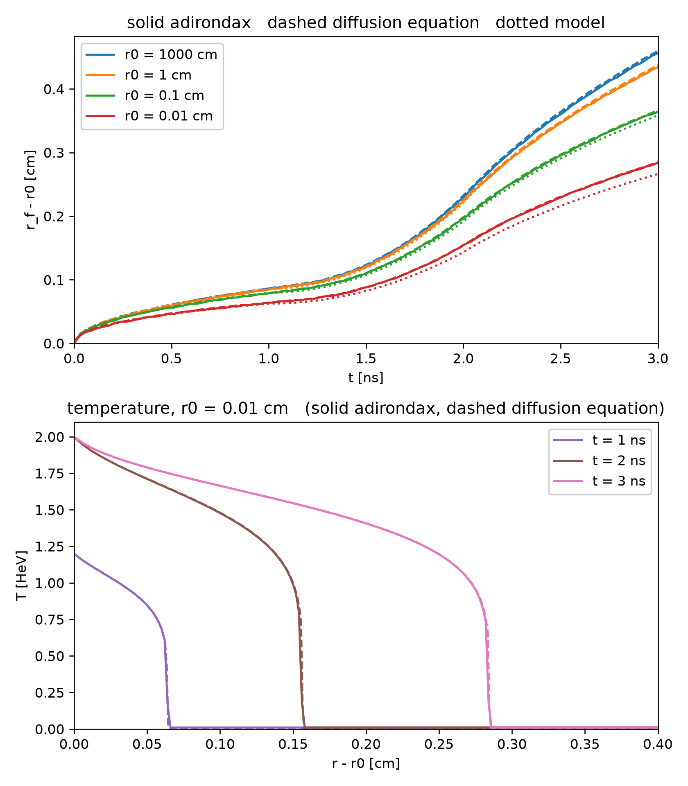

# Marshak wave

Simulate a cylindrical Marshak wave (radiation diffusion), and compare against
the diffusion equation and semi-analytic model of Smith, Bursch & McClarren (2025)

Philip Mocz (2026)

Usage:

```console
python marshak_wave.py
```

Takes around 30 seconds to run on my macbook (cpu).

A hot inner region of radius `r0` launches a radiation heat wave (a Marshak
wave) outwards into cold, opaque C6H12 foam (0.05 g/cc). Its temperature is held
at 1.2 HeV for 1 ns, then ramps up to 2 HeV at 2 ns. The foam's opacity falls
steeply as it heats up, as `T^-2.98`, so the heated foam is far more transparent
than the cold, and the wave advances with a sharp front. The smaller `r0`, the
more the wave slows as it spreads out in the cylinder. The foam is static: it
only exchanges energy with the radiation.

This is the cylindrical test problem of Smith, Bursch & McClarren (2025), for
the inner radii `r0` = 1000 cm (effectively planar), 1, 0.1 and 0.01 cm. The
script solves their diffusion equation independently, by finite volumes and
backward differentiation (dashed lines), and integrates their semi-analytic
model of the heat front (dotted lines). The adirondax heat front (solid lines)
agrees with the diffusion equation to within 2% at every radius and time, and
so do its temperature profiles; the model falls behind at small radii, as the
paper reports.

The paper's equation neglects the energy held by the radiation, and holds the
radiation and the foam at one temperature. To match it, the foam's specific heat
is taken to be ten times that of a fully ionized CH plasma (and its opacity
scaled to keep the paper's diffusion coefficient), and its Planck opacity a
hundred times its Rosseland opacity. With the realistic specific heat, the
radiation's own heat capacity, about a tenth of the foam's at 2 HeV, slows the
wave by a few percent.

The radiation is solved by flux-limited diffusion, without a limiter (as in the
paper), and with the diffusion coefficient on each face averaged arithmetically
between its two cells: averaged harmonically, the opacity of the cold foam would
choke the front.

The movie shows the temperature across the cylinder for `r0` = 0.1 cm.


## Simulation snapshots

<div style="display:flex;flex-wrap:wrap;gap:8px">
  
  
</div>


## References

[Smith, E., Bursch, E. M. & McClarren, R. G.; Consistent Solutions of the Radiation Diffusion Equation in Spherical and Cylindrical Geometries. arXiv:2502.07930 (2025)](https://arxiv.org/abs/2502.07930)

[Hammer, J. H. & Rosen, M. D.; Physics of Plasmas 10, 1829 (2003)](https://www.osti.gov/servlets/purl/15002150)
