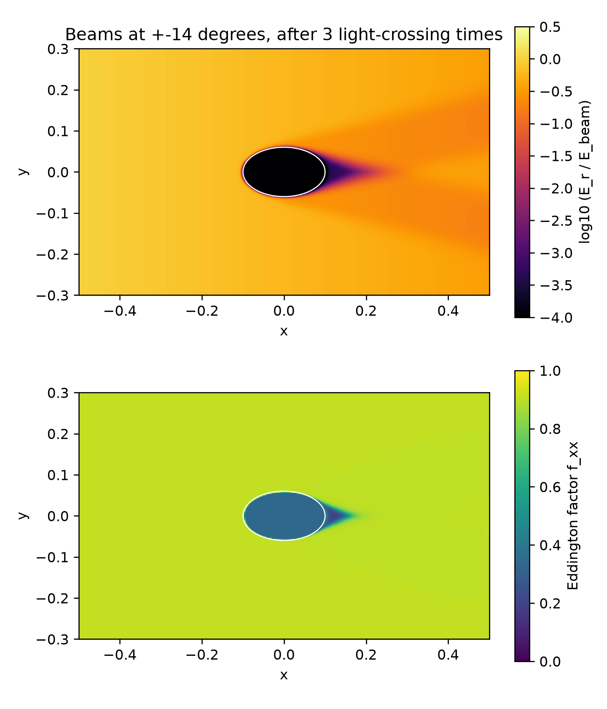

# Shadow

Simulate the shadow cast by an optically thick cloud (radiation transport)

Philip Mocz (2026)

Usage:

```console
python shadow.py
```

Takes around 9 minutes to run on my macbook (cpu).

Two beams of photons enter through the left boundary, at about ±15 degrees to
the horizontal, and cross a box of optically thin gas (optical depth ~1) that
holds a dense, cold cloud (optical depth > 10^5). The cloud absorbs the beams and
casts a sharp shadow: an umbra where it blocks both beams, and a penumbra on
either side where it blocks only one. Radiation treated by flux-limited
diffusion, or as a fluid (M1), cannot hold such a shadow, because it flows down
the gradient of the radiation energy density into the shadowed region. Discrete
ordinates follow each direction separately, and so cast the shadow.

The radiation is followed for three light-crossing times of the box. Since the
radiation constant is small, the radiation barely changes the gas over that time.

The movie shows the radiation energy density as the beams first cross the box
(the `rad*.png` checkpoints). The lower panel of the summary plot shows the
Eddington factor `f_xx = P_xx / E_r`: about 0.9 in the beams, which are strongly
forward-peaked, and 1/3 inside the cloud, where the radiation is isotropic.


## Simulation snapshots

<div style="display:flex;flex-wrap:wrap;gap:8px">
  
  
</div>


## References

[Jiang, Y.-F.; An Implicit Finite Volume Scheme to Solve the Time-dependent Radiation Transport Equation Based on Discrete Ordinates. The Astrophysical Journal Supplement Series (2021)](https://ui.adsabs.harvard.edu/abs/2021ApJS..253...49J)

[Hayes, J. C. & Norman, M. L.; Beyond Flux-limited Diffusion: Parallel Algorithms for Multidimensional Radiation Hydrodynamics. The Astrophysical Journal Supplement Series (2003)](https://ui.adsabs.harvard.edu/abs/2003ApJS..147..197H)
